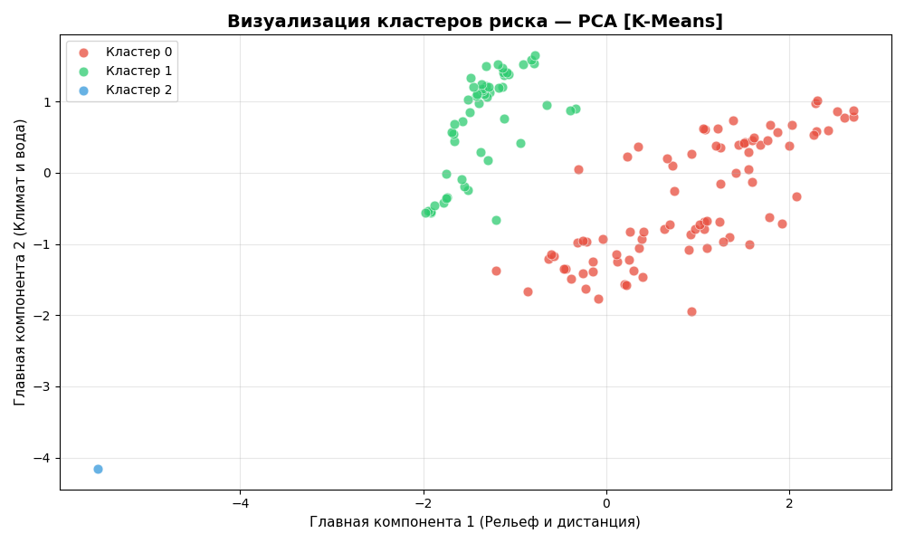

# Комплексная документация: Мультиагентная Геоинформационная Система

## 1. Введение и Архитектура Системы
Система представляет собой интеллектуальный мультиагентный программный комплекс для сбора, анализа и прогнозирования рисков на туристических маршрутах. Архитектура построена на микросервисной и конвейерной (pipeline) модели.

### Схема взаимодействия
Система состоит из трёх ключевых слоев, взаимодействующих через централизованную базу данных:
1. **Слой Data Engineering** (Модуль А): Агенты собирают треки, обогащают их гео-тегами через Overpass API и складируют данные в СУБД PostgreSQL.
2. **Слой ML & Analytics** (Модули Б и В): Агенты извлекают датасет из БД, кластеризуют маршруты математическими алгоритмами, а затем обучают предсказательную модель (Random Forest), сохраняя конфигурацию в бинарный файл.
3. **Слой Backend & Frontend** (Модуль Г): FastAPI-сервер подгружает веса обученной модели и в реальном времени отдаёт предсказания по HTTP-протоколу REST визуальному дашборду на базе Streamlit (Plotly).

---

## 2. Описание ролей каждого агента

### Модуль А. Извлечение и подготовка (Data Pipeline)
* **`agent_1_data_loader.py`**: Загрузчик. Парсит туристические треки, накладывает их на топографические карты, формирует базовые таблицы в БД.
* **`agent_1_2_enrichment.py`**: Гео-агент. Работает с Overpass API. Извлекает радиус леса, водоемы и объекты для каждой координаты.
* **`agent_1_3_analysis.py`**: Анализатор. Строит графики плотности признаков, выявляет дисбалансы.
* **`agent_1_5_augmentation.py`**: Агент-аугментатор. Применяет библиотеку `Albumentations` для геометрического искажения фото-треков с целью расширения датасета.

### Модуль Б. Аналитика и Разметка
* **`agent_2_dashboard.py`**: Аналитическая система. Дашборд BI (Plotly/Dash) со встроенным ролевым доступом (Admin/User).
* **`agent_2_3_clustering.py`**: Агент авто-разметки рисков. Использует DBSCAN и K-Means для выявления 3 классов опасности. Пишет финальные кластеры обратно в БД.

### Модуль В. Моделирование (AI)
* **`agent_3_1_modeling.py`**: ML-агент. Обучает классификатор. Контролирует метрики и решает проблемы дисбаланса. Осуществляет экспорт пайплайна.
* Концепция **CT (Continuous Training)** и прогнозирования временных рядов имплементирована в архитектуру для расчета будущих рисков затопления/пожаров.

### Модуль Г. Интеграция (Микросервисы)
* **`agent_4_1_api.py`**: Сервер интеграции. API-мост (FastAPI) между ML-моделью и внешним миром.
* **`agent_4_2_app.py`**: GUI клиент. Пользовательский интерфейс-карта на платформе Streamlit, позволяющий планировать будущие походы.

---

## 3. Обоснование выбранных технологий
* **PostgreSQL + pg8000**: Выбрана как надежная транзакционная БД. В отличие от SQLite, она обеспечивает корректную параллельную (асинхронную) работу микросервисов.
* **Scikit-Learn (Random Forest)**: Выбран для табличных данных. Метод ансамблей (деревьев решений) лучше нейросетей справляется с перепадами масштабов геокоординат и нелинейной зависимостью температур.
* **FastAPI**: Идеальное решение для внедрения ML в production. Асинхронный ASGI сервер + автоматическая автогенерация Swagger-документации на лету.
* **Streamlit & Plotly Mapbox**: Обеспечивает мгновенный рендер интерактивных карт без необходимости писать сложный код на JavaScript. Plotly работает эффективнее `pydeck` на старых окружениях.

---

## 4. Структура проекта
```text
/map
├── agent_1_*.py           # Скрипты парсинга, гео-обогащения и аугментации
├── agent_2_*.py           # Аналитика и Разметка (DBSCAN/K-Means)
├── agent_3_*.py           # Тренировка ML моделей
├── agent_4_1_api.py       # Backend сервис (порт 8000)
├── agent_4_2_app.py       # Frontend приложение (порт 8501)
├── models/
│   └── risk_classifier.pkl # Экспортированные веса нейросети
├── analysis_reports/      # Каталог сгенерированных графиков и метрик
├── requirements.txt       # Манифест зависимостей среды
└── Системная_Документация_5.1.md # Этот файл
```

---

## 5. Инструкции по установке и запуску

**Шаг 1. Клонирование и настройка окружения**
Установите все зависимости проекта из манифеста.
```bash
pip install -r requirements.txt
pip install fastapi uvicorn pydantic joblib streamlit plotly pg8000 scikit-learn
```
Убедитесь, что у вас запущен локальный сервер PostgreSQL, и доступна база `tourism_data` (порт 5432).

**Шаг 2. Инициализация конвейера данных (Data Pipeline)**
Для чистого развертывания запустите последовательно агентов подготовки:
```bash
python agent_1_data_loader.py
python agent_2_3_clustering.py
python agent_3_1_modeling.py
```
*Убедитесь, что в папке `models/` появился файл `risk_classifier.pkl`.*

**Шаг 3. Запуск серверов интеграции**
Откройте **Терминал 1** (API):
```bash
uvicorn agent_4_1_api:app --host 127.0.0.1 --port 8000
```
Откройте **Терминал 2** (Графический дашборд):
```bash
streamlit run agent_4_2_app.py
```

Система развернута. Перейдите по адресу `http://localhost:8501` для работы.

---

## 6. Скриншоты ключевых компонентов

*(Места для скриншотов вашей системы:)*

1. **Метрики Кластеризации:**  
     
   *(Визуализация разбиения рельефа на уровни риска).*

2. **Интерфейс API Swagger:**  
   *(Скриншот открытой ссылки http://127.0.0.1:8000/docs — сделайте его через инструмент 'Ножницы')*

3. **Интерактивная карта (GUI Streamlit):**  
   *(Скриншот клиентской карты с результатами предсказания 'Безопасно / Опасность')*
